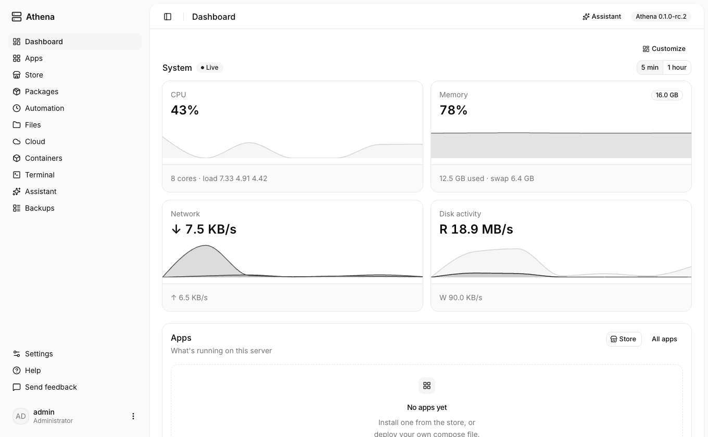

# Athena

**A self-hosted home server dashboard for Linux, macOS and Windows.**

Athena manages containers, apps, host packages, files and cloud storage from one web dashboard, and includes an AI assistant that can operate it all. It runs on Linux, macOS and Windows: it detects what your machine has and only shows what works there. See [how it compares](docs/user-guide/comparison.md) with other home server panels.



## What 0.1.0 does

- **Apps**: an app store plus custom apps from `docker run` commands or `compose.yaml`. Uses Docker Engine on Linux, [Colima](https://github.com/abiosoft/colima) on macOS, and Docker Engine in WSL2 or Podman on Windows.
- **Packages**: install and update host software with apt, dnf, pacman, zypper, apk, flatpak, snap, Homebrew, winget, Scoop or Chocolatey, whichever your system has.
- **Dashboard**: live CPU, memory, disk and network stats, plus app status.
- **Terminal**: a web terminal for the host and for containers.
- **Files and sharing**: a file manager, share links and WebDAV shares.
- **Cloud storage**: Google Drive, OneDrive, Dropbox, S3 and more through [rclone](https://rclone.org).
- **AI assistant**: built on [Pydantic AI](https://ai.pydantic.dev). It works with cloud models or local Ollama, and asks for your approval before changing anything.
- **Automation**: cron and webhook triggers, and an MCP server.
- **Remote access and HTTPS**: tunnels, and HTTPS with a local CA or Let's Encrypt.
- **Appearance**: switch base color, theme, chart colors, fonts and radius live.

## Supported systems and requirements

- **Systems:** Linux (systemd), macOS (launchd, Homebrew) and Windows (start at logon).
- **CPUs:** 64-bit only, amd64 and arm64 (including a Raspberry Pi 4 or 5 running 64-bit Raspberry Pi OS). The installer refuses a 32-bit system.
- **Container runtime:** the installer sets up Docker Engine on Linux (skip with `--no-runtime`) and Colima with Homebrew on macOS. On Windows it doesn't install one: bring Docker Engine in WSL2, Podman or Rancher Desktop, and the installer prints the steps when none is found.
- **Python and uv:** the installer installs [uv](https://docs.astral.sh/uv/) if missing, and uv provides Python.
- On macOS, run the installer as your normal user, not root.

Athena uses open-source dependencies only. Read the [user guide](docs/user-guide/README.md) for how to use each page, or the design in [docs/design/README.md](docs/design/README.md).

## Install

**Linux / macOS**

```bash
curl -fsSL https://github.com/Promethean-Works/athena/releases/latest/download/install.sh | bash
```

**Windows** (PowerShell)

```powershell
irm https://github.com/Promethean-Works/athena/releases/latest/download/install.ps1 | iex
```

Then open `http://<your-server-ip>:8420`. The first visit asks you to create the administrator account. Run the script with `--help` (or `-Help` on Windows) to see options such as a specific version, a dry run, or uninstall. The installer checks the wheel against the release's `SHA256SUMS` before installing it.

**Upgrade:** run the install command again. It installs the latest release over the old one (or pass `--version <x.y.z>`; `-Version` on Windows) and keeps your data.

**Uninstall:** `--uninstall` removes Athena and keeps its data; add `--purge` to delete the data folder too.

```bash
curl -fsSL https://github.com/Promethean-Works/athena/releases/latest/download/install.sh | bash -s -- --uninstall [--purge]
```

On Windows, use `-Uninstall [-Purge]` with the PowerShell form that takes options (see `-Help`).

## Command line

The `athena` command (`athena --help`):

| Command | What it does |
|---|---|
| `serve` | run the server |
| `start`, `stop` | start or stop the server in the background |
| `service install\|uninstall\|status` | register Athena to start automatically, or remove it |
| `doctor` | host and server diagnostics |
| `admin reset-password` | set a new password for an account |
| `config path\|show\|check\|reset` | find, check or reset `athena.json` |
| `https status\|off` | show HTTPS settings, or turn HTTPS off |
| `openapi` | print or write the OpenAPI schema |

## Known limitations

- Linux install and uninstall of packages was checked with apt only; dnf, pacman, zypper and apk, and every Windows package manager, are not yet tested on real hosts.
- The Windows terminal (ConPTY and PowerShell) and the container shell through Docker in WSL are tested in CI only.
- HTTPS with Let's Encrypt or Cloudflare, and trusting the local CA on real devices, are not yet verified. The last renewal result is kept in memory only.
- Tunnels: a Cloudflare quick tunnel is tested for real; named tunnels, ngrok, Tailscale and Windows are not.
- The assistant's browser tool is blocked by an upstream dependency conflict and is off.
- Durable execution of assistant turns is experimental.
- Store apps were install-tested on macOS arm64; logins and real use of each app are not verified, and a few heavy apps are marked as skipped.


**Forgot the admin password?** Run this on the server (with `sudo` on Linux), then sign in with the new password. All existing sessions are signed out.

```bash
athena admin reset-password
```

**A setting broke Athena?** Settings are kept in one file, `athena.json`, in the data folder (`/var/lib/athena` on Linux, `~/Library/Application Support/Athena` on macOS, `%LOCALAPPDATA%\Athena\data` on Windows). If a bad value keeps Athena from starting, or locks you out (a wrong port, HTTPS), fix it in any text editor and restart Athena. On Linux, edit it with `sudo`.

```bash
athena config path            # where the file is
athena config check           # what's wrong with it, with line numbers
athena config reset https     # or server, system, ai, webdav: back to defaults
athena https off              # just turn HTTPS off
```

Athena refuses to start with an invalid file rather than guessing, and keeps the version before the last save as `athena.json.bak`. Changes you make by hand apply when Athena restarts.

## Development

The project is a monorepo: a Next.js + shadcn/ui frontend (pnpm + Turborepo) and a Python backend (uv). **[docs/DEVELOPMENT.md](docs/DEVELOPMENT.md)** is the full guide: setting up a machine (including AI coding agents, with one command), the daily workflow, and troubleshooting. To contribute: clone, run `scripts/bootstrap.sh`, and follow the quick start in [CONTRIBUTING.md](CONTRIBUTING.md).

**Requirements:** Node.js 20.9+, [pnpm](https://pnpm.io), and [uv](https://docs.astral.sh/uv/).

```bash
pnpm install
cd apps/server && uv sync && cd ../..
```

Run the backend and the frontend in two terminals:

```bash
cd apps/server && uv run athena serve --reload --port 8420
```

```bash
pnpm dev
```

Open http://localhost:3000. `next dev` proxies `/api` to the server on port 8420, and the API docs are at http://localhost:8420/api/docs.

| Task | Command |
|---|---|
| Lint, typecheck, build the web app | `pnpm lint`, `pnpm typecheck`, `pnpm build` |
| Server tests and lint | `cd apps/server && uv run pytest && uv run ruff check` |
| Regenerate the API client after changing server routes | `pnpm gen:api` |
| Add a shadcn component | `pnpm dlx shadcn@latest add <name> -c apps/web` |

| Path | What |
|---|---|
| `apps/web` | Next.js app (static export), app shell from the shadcn `dashboard-01` block |
| `packages/ui` | shadcn/ui components shared by the app |
| `packages/api-client` | Typed API client generated from the server's OpenAPI schema |
| `apps/server` | FastAPI server and the `athena` CLI (`serve`, `start`, `stop`, `openapi`, `service install\|uninstall\|status`, `doctor`, `config path\|show\|check\|reset`, `https status\|off`, `admin reset-password`) |

More reading:

- [docs/design/README.md](docs/design/README.md): architecture and decisions
- [CONTRIBUTING.md](CONTRIBUTING.md): branches, commits and pull requests
- [docs/DEVELOPMENT.md](docs/DEVELOPMENT.md): machine setup, agents, daily workflow, troubleshooting
- [AGENTS.md](AGENTS.md): instructions for AI coding agents (Claude Code, OpenCode, Hermes Agent, oh-my-pi)

## Security

Please report vulnerabilities privately. See [SECURITY.md](SECURITY.md).

## Attribution — CasaOS

Parts of Athena's app catalog were imported from the [CasaOS AppStore](https://github.com/IceWhaleTech/CasaOS-AppStore) (Apache-2.0) by IceWhaleTech. Athena's catalog importer translates CasaOS `x-casaos` compose metadata into Athena's own `x-athena` format. We credit the CasaOS team for those imported apps only — the rest of Athena, including the app you're building, has nothing to do with CasaOS.

**No partnership or endorsement.** Athena is an independent project. It is not affiliated with, partnered with, sponsored by, endorsed by, or approved by CasaOS or IceWhaleTech, and nothing in this repository states or implies any such relationship. CasaOS and related names and trademarks are the property of their respective owners.

This section is attribution only; it does not create any legal relationship between Athena and CasaOS.

## License

[Apache-2.0](LICENSE)
