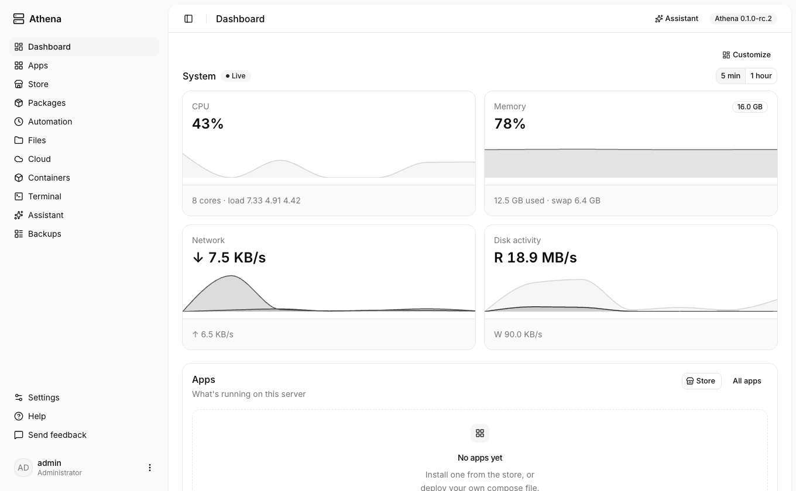

# Athena user guide

Athena is a self-hosted control panel for your home server. It runs on Linux, macOS and Windows, and shows only what your machine supports.

## Contents

1. [Getting started](getting-started.md): install, first sign-in, upgrade, uninstall
2. [Dashboard](dashboard.md): live stats and your apps
3. [Apps and the store](apps-and-store.md): install from the store or from your own compose file
4. [Packages](packages.md): host software through apt, Homebrew, winget and others
5. [Files and sharing](files-and-sharing.md): file manager, share links, WebDAV and SMB
6. [Cloud storage](cloud-storage.md): Google Drive, OneDrive, S3 and more through rclone
7. [Containers and terminal](containers-and-terminal.md)
8. [AI assistant](assistant.md)
9. [Automation](automation.md): cron, webhooks and the MCP server
10. [Backups](backups.md)
11. [Remote access and HTTPS](remote-access-and-https.md)
12. [Settings](settings.md): appearance, account, system, AI
13. [Command line](command-line.md): the `athena` command
14. [Troubleshooting](troubleshooting.md)
15. [Comparison with other panels](comparison.md)

Developers: see [DEVELOPMENT.md](../DEVELOPMENT.md) and the design notes in [docs/design](../design/README.md).

## Which pages you see

Athena detects what your host can do (a container runtime, rclone, a package manager, a tunnel tool) and hides what it can't. If a page or button from this guide is missing, that capability isn't available on your machine. The [troubleshooting page](troubleshooting.md) shows how to find out why.
