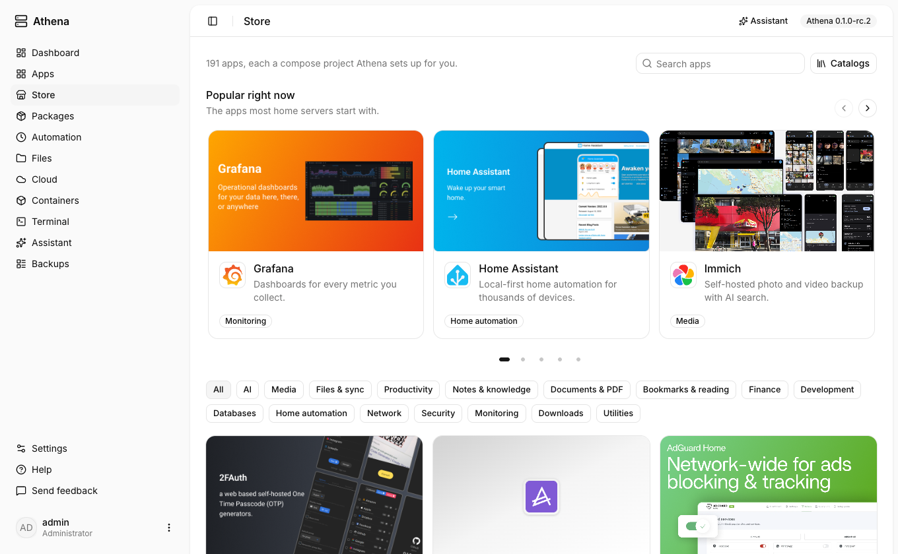

# Apps and the store

An app in Athena is a [Compose](https://docs.docker.com/compose/) project. Athena installs it, keeps its files under its own folder, and starts and stops it for you. This needs a [container runtime](getting-started.md#requirements).

## The store

**Store** lists about 190 ready-made apps, from Jellyfin and Immich to Home Assistant and Grafana. Search by name or filter by category. Apps that don't run on your CPU are hidden behind **Show them** and can't be installed.

To install one:

1. Open it from the store.
2. Fill the install form. It has sensible defaults (port, timezone, data folder), and the less common options are under advanced. If an app has variants (for example FreshRSS with PostgreSQL) you pick one first.
3. Click install. A job window streams the progress. It can take a while when images are large.

Passwords and other answers are stored in the app's `.env` file, readable only by you.

**Catalogs.** The built-in catalog is one of several possible. **Store → Catalogs** adds your own from a Git repository or URL.

## Your own apps

**Apps → New** deploys anything else, either by pasting a `compose.yaml` or a `docker run` command. A plain compose file works with no extra metadata.

## Managing apps

**Apps** lists everything installed. Open an app to start, stop, restart or update it, read its logs, edit its settings, open its web page, or remove it. Removing asks whether to delete its data as well. Updating can take a [backup](backups.md) of the app first.

## Good to know

- Each app lives in `<data folder>/apps/<name>`: `compose.yaml`, `.env` and a `data` folder.
- Athena only manages the apps it installed. Containers you started by hand appear under [Containers](containers-and-terminal.md) but aren't apps.
