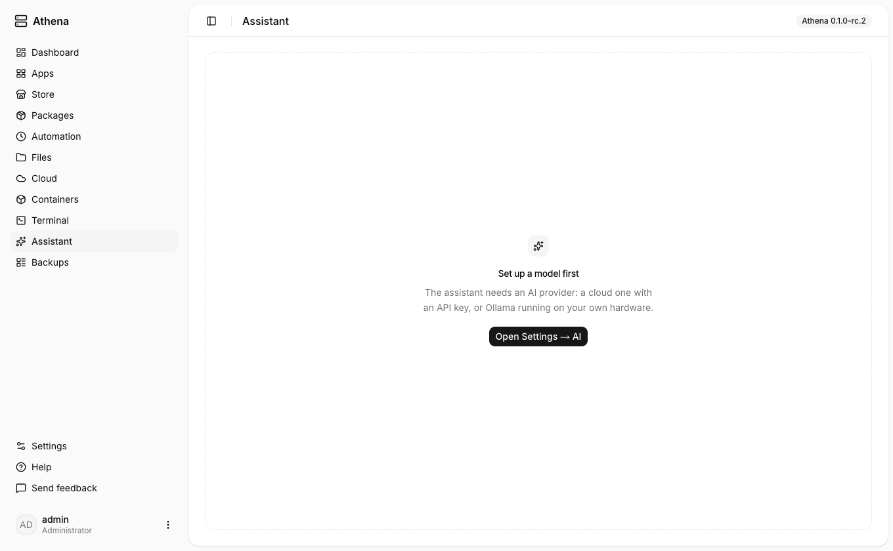
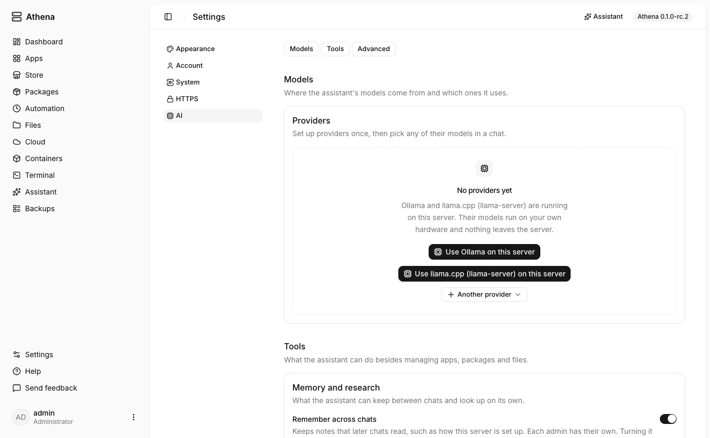

# AI assistant

An assistant that can use Athena for you: "install Jellyfin", "what is using the disk?", "upgrade my packages". It is built on [Pydantic AI](https://ai.pydantic.dev).

## Set up a model

The assistant needs a model provider. Open **Settings → AI** and add one:

- **Ollama** or **llama.cpp** running on the server: the model runs on your own hardware and nothing leaves the machine.
- A cloud provider with your own API key. Keys are stored encrypted.

Under **Tools** you choose what the assistant may do besides managing apps, packages and files: remembering notes across chats, looking things up on the web, running shell commands (off by default) and more.

## Chat

Open **Assistant** (or the shortcut in the header) and write what you want. It answers, shows what it ran, and **asks for your approval before it changes anything**: installing an app, editing a file, running a command. Read the approval card before you accept.

The assistant only offers actions your host supports. Everything it does is recorded in the audit log.

> Two parts aren't ready yet: the assistant's browser tool is off because of an upstream conflict, and durable execution of turns is experimental.
