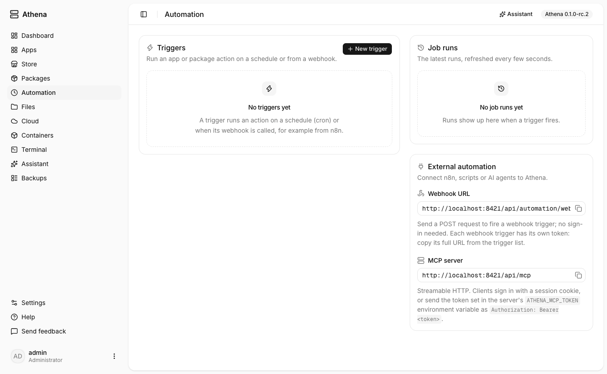

# Automation



## Triggers

A trigger runs an action when something happens. Click **New trigger**, then choose:

- **When:** a schedule (a cron expression such as `0 3 * * *` for every day at 03:00), or a **webhook**.
- **What:** an app action (start, stop, restart, update) or a package action (install, uninstall, upgrade, refresh).

Triggers can be switched on and off. **Job runs** shows what ran, when, and whether it worked.

## Webhooks

A webhook trigger gets its own URL with a secret token. Send a POST request to it from n8n, a script or anything else:

```bash
curl -X POST http://your-server:8420/api/automation/webhook/<token>
```

No sign-in is needed, so the token is the credential: keep the URL private. Copy it from the trigger in the list.

## MCP server

Athena is also an [MCP](https://modelcontextprotocol.io) server at `/api/mcp` (streamable HTTP), so AI agents and tools can list apps, check host stats, run app actions and manage triggers. Clients sign in with a session cookie, or with a token: set `ATHENA_MCP_TOKEN` in the server's environment and send `Authorization: Bearer <token>`. A token acts as the first admin account, and what it changes is audited.
