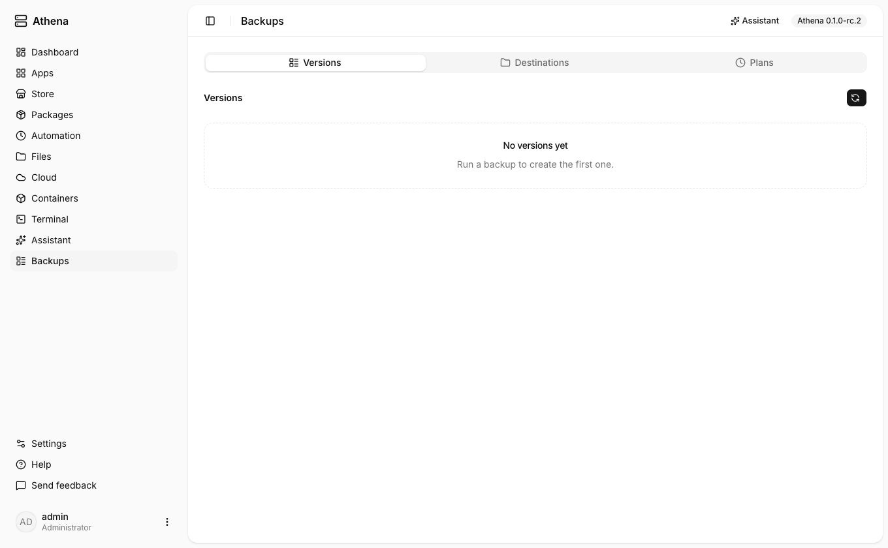

# Backups

Back up Athena and its apps on a schedule, encrypted and deduplicated, to a local folder or disk or to any [cloud remote](cloud-storage.md). Backups use [restic](https://restic.net), which Athena downloads and checks by itself.

The page has three tabs:

- **Destinations:** where backups go. A local destination must be an absolute folder you can write to, and not inside Athena's data folder. A cloud destination needs rclone.
- **Plans:** what to back up and when. A plan picks **Athena** itself (database, settings, encryption key, certificates) and any apps. Each one is kept as its own version, so restoring one app doesn't touch the others. A plan also sets how many versions to keep.
- **Versions:** every backup taken, with date and size. Restore any one.

Apps are stopped briefly while their files are copied, so each copy is consistent. Named Docker volumes are included.

## Restore

- **One app:** restore a version from Versions, or from the app's page. Useful after a broken update or deleted data.
- **All of Athena** on a new host: install Athena, then restore from the first-run screen, or use `athena restore` from the command line.

Each destination is encrypted with a password Athena generates. It is shown once, in a recovery kit, when you create the destination. Save it somewhere safe: without it the backups can't be read.

## What isn't backed up

The operating system, your home folders, and any folder no app uses. Athena isn't a general backup tool.
