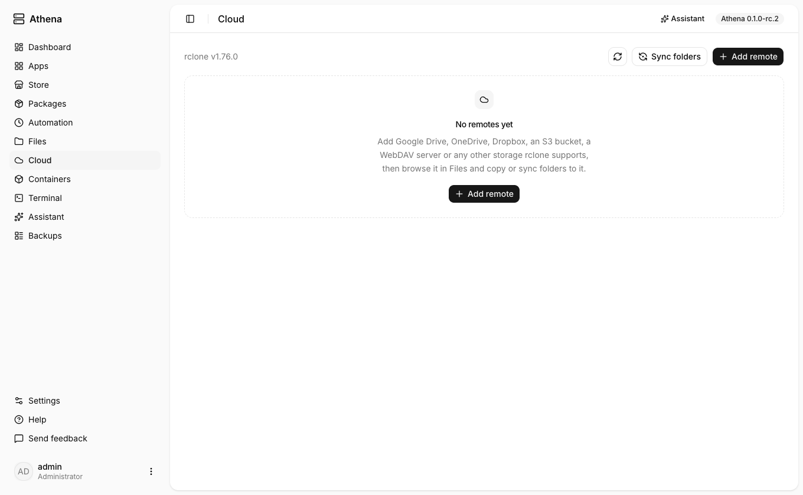

# Cloud storage

Athena connects to Google Drive, OneDrive, Dropbox, S3, WebDAV servers and many more through [rclone](https://rclone.org). The **Cloud** page appears when rclone is available.

## Add a remote

1. Click **Add remote** and pick the provider.
2. Answer the questions. Secrets are stored encrypted and never shown again.
3. For providers that sign in through a browser (Google Drive, OneDrive, Dropbox), Athena shows a command to run on *your own computer*: `rclone authorize "<provider>"`. Sign in there, and paste the token it prints back into Athena. This is needed because the browser sign-in can't redirect to a server you reach over the network.

Cancelling halfway removes the half-made remote.

## Use it

- Browse and manage the remote in **Files**, like a local folder.
- **Sync folders** copies or syncs a folder between this server and a remote, with progress.
- Remotes can be a destination for [backups](backups.md).

Athena keeps its own rclone configuration inside its data folder; your own `rclone.conf` is never read or changed.
