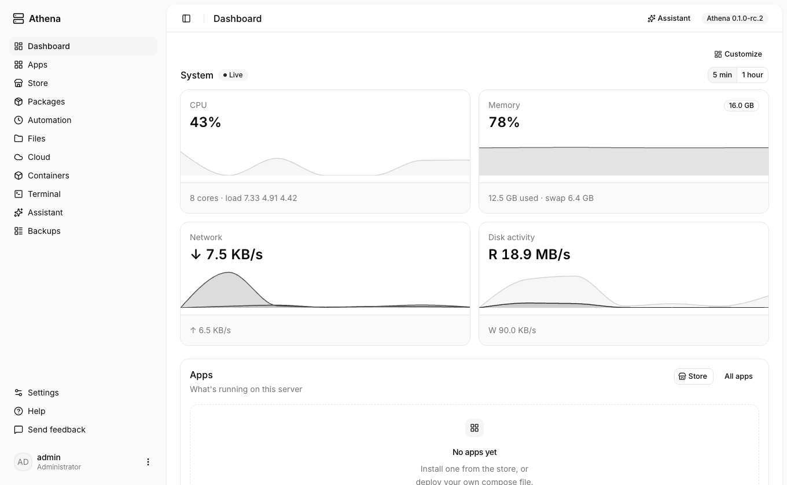

# Dashboard

The home page shows how the server is doing right now, and the apps running on it.

- **System:** CPU, memory, network and disk activity, updated live. Switch the chart range between 5 minutes and 1 hour at the top right.
- **Apps:** a tile for each installed app with its status. Click one to open it. **Store** and **All apps** are shortcuts.
- **Customize:** choose which cards appear and in what order.

The header has a shortcut to the [assistant](assistant.md) and shows the Athena version. The sidebar lists every page; the user menu at the bottom has your account and sign-out.
