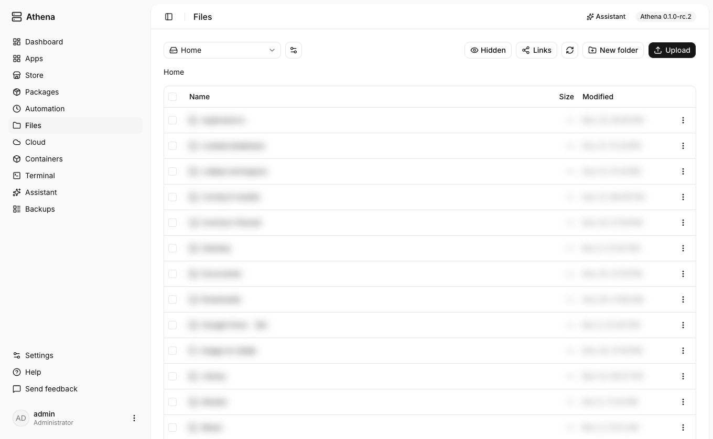

# Files and sharing

## File manager

**Files** browses the server's folders from your browser. It only shows **locations** that an admin has added, never the whole disk. By default Athena adds your home folder and the apps' data folder.

- **Upload** sends files in pieces, so large files work. **New folder** creates a folder.
- Select entries to download (folders arrive as a zip), rename, copy, move, or delete. Deleting goes to the trash where your OS supports it.
- Copy and move work across locations and run as a job. When a name already exists you choose to keep both, skip, or replace.
- **Hidden** shows or hides dotfiles.
- The location picker at the top left switches location. Its settings button adds, edits or removes locations (admins only). Removing a location never deletes its files.
- Text files up to 2 MB open in an editor.

## Share links

Select a file or folder and choose share to make a link anyone can open without an account. **Links** lists the ones you made so you can copy or revoke them. Anyone with the link can read it, so treat it like a password.

## Network shares

- **WebDAV:** turn it on in **Settings → System** (it's off by default). The server then serves your locations at `/dav/`, with its own password: anyone who has it can read and change every location. Windows, macOS, Linux file managers and many phone apps can connect to it.
- **SMB:** **Files → SMB** manages Samba shares for machines on your network, where the host supports it.

## Cloud folders

Remotes you add under [Cloud storage](cloud-storage.md) appear in the same file manager.
