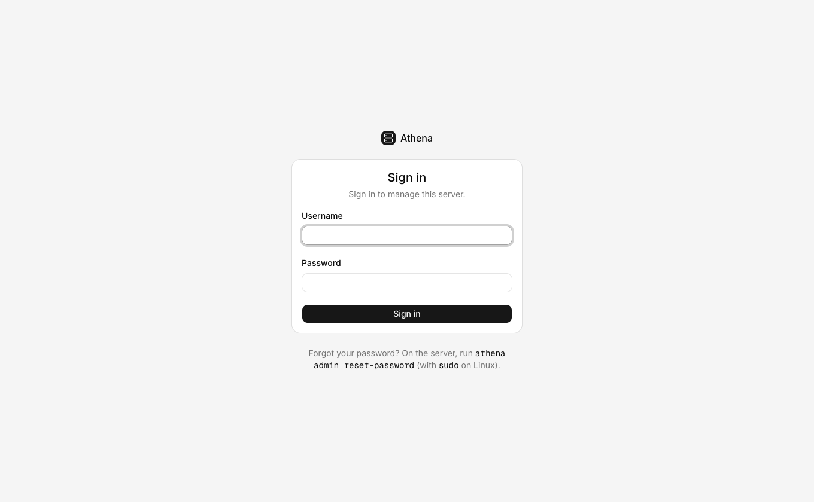

# Getting started

## Requirements

- **System:** Linux (systemd), macOS (launchd, Homebrew) or Windows.
- **CPU:** 64-bit, amd64 or arm64. A Raspberry Pi 4 or 5 running 64-bit Raspberry Pi OS works. The installer refuses a 32-bit system.
- **Container runtime** (needed for apps): the installer sets up Docker Engine on Linux and [Colima](https://github.com/abiosoft/colima) on macOS. On Windows bring your own: Docker Engine in WSL2, Podman or Rancher Desktop. The installer prints the steps when it finds none.
- **Python:** nothing to do. The installer installs [uv](https://docs.astral.sh/uv/), which provides Python.
- On macOS run the installer as your normal user, not root.

## Install

**Linux and macOS**

```bash
curl -fsSL https://github.com/Promethean-Works/athena/releases/latest/download/install.sh | bash
```

**Windows** (PowerShell)

```powershell
irm https://github.com/Promethean-Works/athena/releases/latest/download/install.ps1 | iex
```

The installer checks the download against the release's `SHA256SUMS` before installing it, then registers Athena to start automatically. Run the script with `--help` (`-Help` on Windows) to see every option: a specific version, a dry run, skipping the container runtime (`--no-runtime`), and uninstall.

## First sign-in

Open `http://<your-server-ip>:8420` in a browser. On the machine itself, that is `http://localhost:8420`.

The first visit asks you to create the administrator account. Nothing else is reachable until you do. After that, sign in with it.



If you forget the password, run this on the server (with `sudo` on Linux):

```bash
athena admin reset-password
```

## Upgrade

Run the install command again. It installs the latest release over the old one and keeps your data. To pin a version, pass `--version <x.y.z>` (`-Version` on Windows).

## Uninstall

`--uninstall` removes Athena and keeps its data. Add `--purge` to delete the data folder too.

```bash
curl -fsSL https://github.com/Promethean-Works/athena/releases/latest/download/install.sh | bash -s -- --uninstall [--purge]
```

On Windows use `-Uninstall [-Purge]` with the PowerShell form that takes options (see `-Help`).

## Where Athena keeps its data

| System | Data folder |
|---|---|
| Linux | `/var/lib/athena` |
| macOS | `~/Library/Application Support/Athena` |
| Windows | `%LOCALAPPDATA%\Athena\data` |

It holds the database, `athena.json` (your settings), the encryption key `secret.key`, and one folder per app. Back it up: see [Backups](backups.md). `athena config path` prints the exact location.
