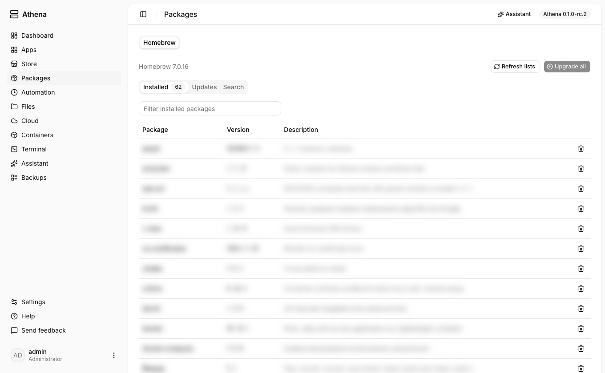

# Packages

Install and update software on the **host** itself, not in containers. Athena uses whichever package managers your system has:

| System | Managers |
|---|---|
| Linux | apt, dnf, pacman, zypper, apk, flatpak, snap |
| macOS | Homebrew |
| Windows | winget, Scoop, Chocolatey |

Open **Packages** to search, see what's installed, install, uninstall, and upgrade. Each action runs as a job with its output streamed, and is recorded in the audit log. Package installs have no off switch yet, so only give admin accounts to people you trust.

Packages are an admin-only feature. [Automation](automation.md) can run package actions (upgrade, refresh) on a schedule.

> Install and uninstall on Linux was checked with apt. The other managers are covered by tests with sample output but haven't been tried on real machines yet.
