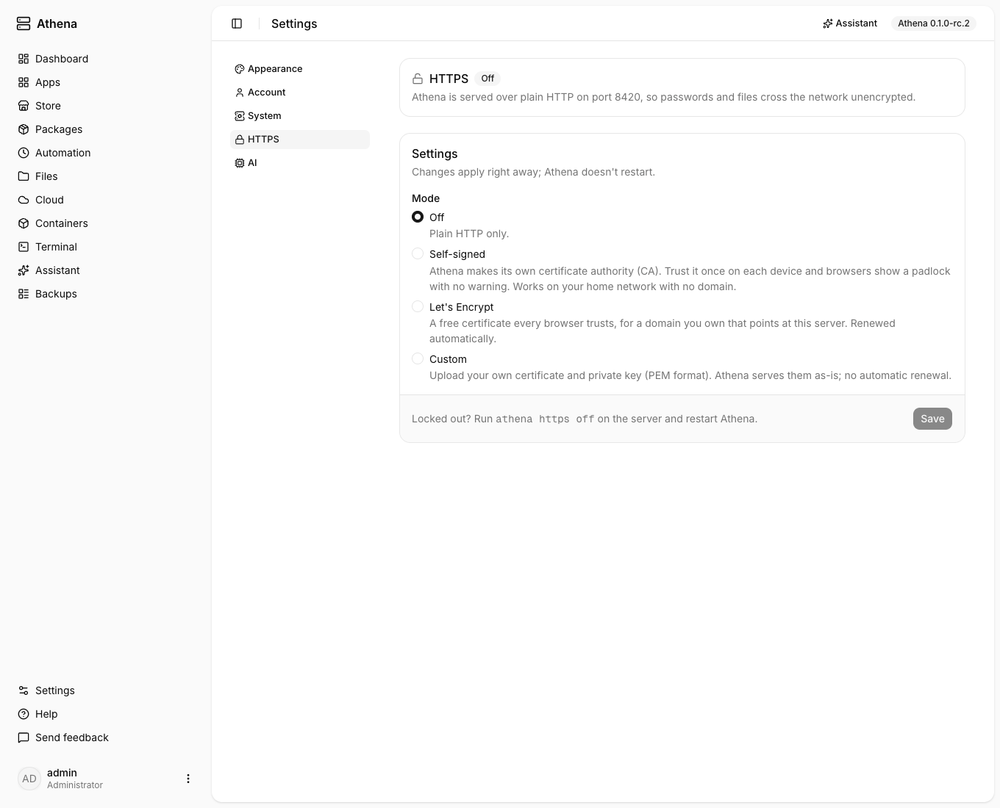

# Remote access and HTTPS

By default Athena listens on your local network (port 8420, plain HTTP). Don't forward that port to the internet. Use one of the options below.

## Remote access with a tunnel

A tunnel makes Athena reachable from outside without opening a port on your router. Turn on **Remote access** in **Settings → System** and pick a provider:

- **Cloudflare Tunnel:** a quick tunnel gives you a temporary `trycloudflare.com` address with no account. A named tunnel uses your Cloudflare account and domain.
- **Tailscale Funnel:** uses your tailnet. The host must be logged in with `tailscale up`, and Funnel must be allowed in the Tailscale admin console.
- **ngrok:** needs an auth token. The free plan has limits.

Tunnels are off by default, admin-only, and their tokens are stored encrypted. Putting Athena on the internet means your sign-in page is public: use a long password.

> A Cloudflare quick tunnel was tested for real. Named tunnels, ngrok, Tailscale and Windows were not.

## HTTPS

In **Settings → HTTPS** choose a mode. Changes apply right away without a restart.

- **Off:** plain HTTP on port 8420. Passwords and files cross the network unencrypted.
- **Self-signed:** Athena makes its own certificate authority (CA). Trust it once on each device and browsers show a padlock with no warning. It works on your home network with no domain.
- **Let's Encrypt:** a free certificate every browser trusts, for a domain you own that points at this server. It renews automatically.
- **Custom:** upload your own certificate and private key (PEM format). Athena serves them as they are, with no automatic renewal.

HTTPS is served on port 8443 in addition to HTTP. If you lock yourself out, run `athena https off` on the server and restart Athena.

> Let's Encrypt, Cloudflare and trusting the local CA on real devices haven't been verified on real hosts yet.
