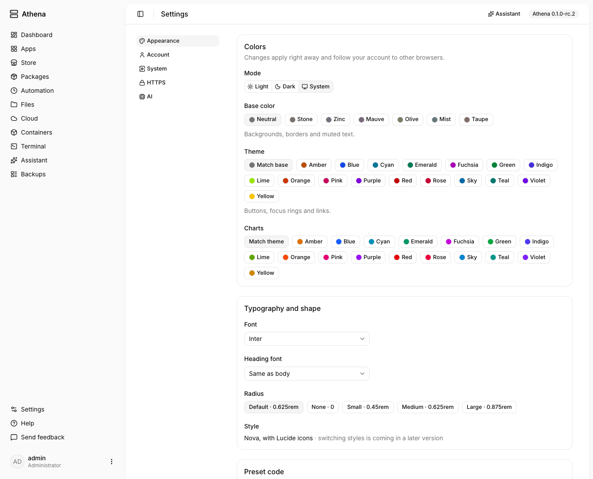
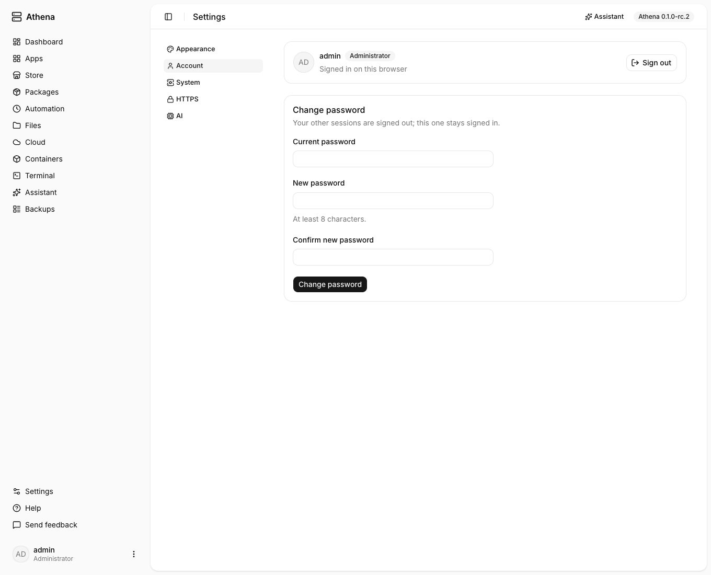
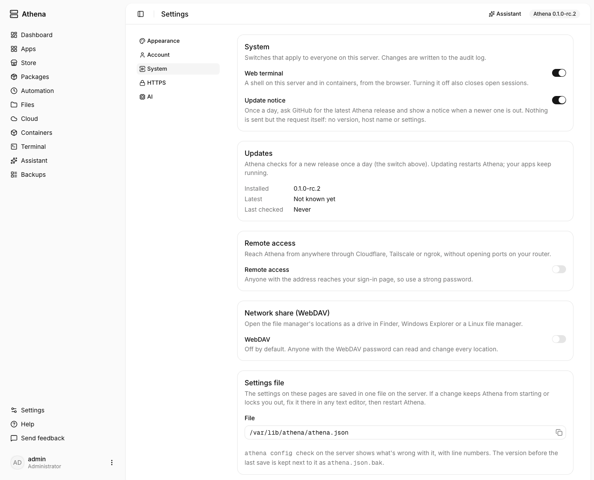
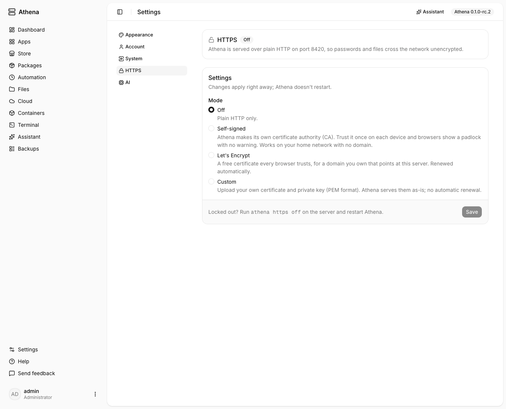
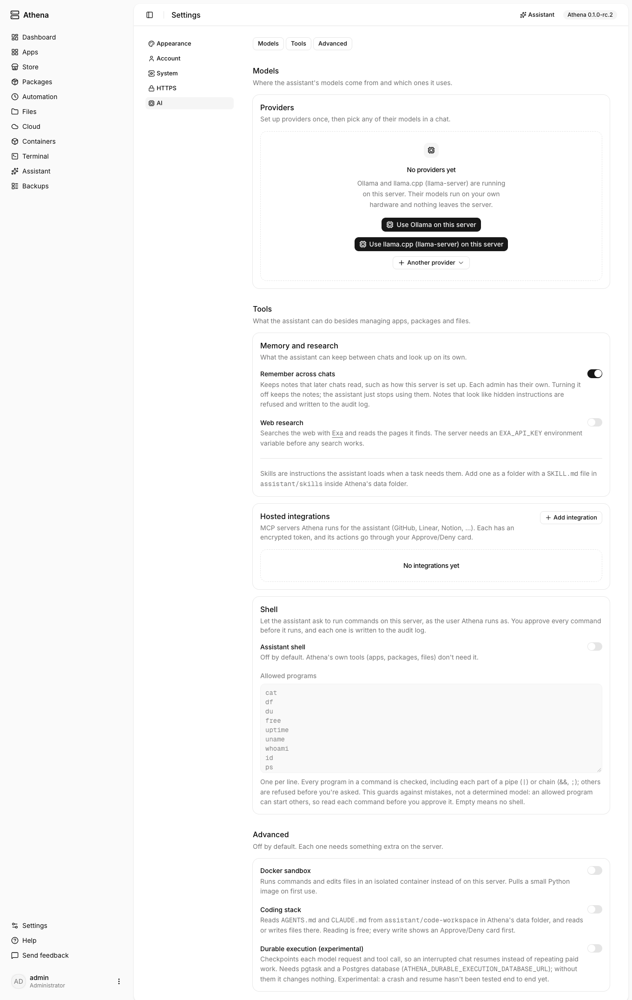

# Settings

Open **Settings** at the bottom of the sidebar. It has five pages: Appearance, Account, System, HTTPS and AI.

## Appearance



Everything here applies right away and follows your account to other browsers.

- **Mode:** light, dark, or follow the system.
- **Base color:** the tint of backgrounds, borders and muted text.
- **Theme:** the color of buttons, focus rings and links.
- **Charts:** the colors of the dashboard charts. "Match theme" uses the theme color.
- **Font, heading font and radius:** change the typeface and how round the corners are.
- **Preset code:** a short code that describes your whole look, so you can copy it to another server.

## Account



Shows who you're signed in as, with a **Sign out** button, and lets you change your password. The new password needs at least 8 characters. Changing it signs out your other sessions and keeps this one.

If you forget your password, use `athena admin reset-password` on the server. See the [command line](command-line.md).

## System



Switches that apply to everyone on this server. Changes are written to the audit log.

- **Web terminal:** the [terminal](containers-and-terminal.md) on or off. Turning it off also closes open sessions.
- **Update notice:** once a day Athena asks GitHub for the latest release and shows a notice when a newer one is out. Nothing is sent but the request itself: no version, host name or settings.
- **Updates:** the installed and latest versions, and when Athena last checked. Updating restarts Athena; your apps keep running.
- **Remote access:** reach Athena from anywhere through Cloudflare, Tailscale or ngrok. See [Remote access and HTTPS](remote-access-and-https.md). Off by default.
- **Network share (WebDAV):** open your file locations as a drive in Finder, Windows Explorer or a Linux file manager. Off by default, with its own password. See [Files and sharing](files-and-sharing.md).
- **Settings file:** shows where `athena.json` is. See below.

## HTTPS



Choose how Athena is served: Off, Self-signed, Let's Encrypt or Custom. Changes apply right away without a restart. See [Remote access and HTTPS](remote-access-and-https.md) for what each mode means.

## AI



One page with three parts, reachable from the tabs at the top.

- **Models:** the providers the assistant can use. Set up Ollama or llama.cpp on this server, or add another provider with an API key.
- **Tools, memory and research:** remember notes across chats, and search the web (needs an `EXA_API_KEY` in the server's environment). You can also give the assistant skills: a folder with a `SKILL.md` file in `assistant/skills` inside the data folder.
- **Tools, hosted integrations:** other MCP services such as GitHub, Linear or Notion. Each has an encrypted token, and its actions go through the approval card.
- **Tools, shell:** let the assistant ask to run commands. Off by default. You approve every command, and only the programs in the allowed list can run.
- **Advanced:** a Docker sandbox for commands and file edits, a coding stack that reads `AGENTS.md` and `CLAUDE.md` from a workspace folder, and durable execution (experimental, needs Postgres). All off by default.

See [AI assistant](assistant.md) for how to use it.

## The settings file

Everything you set is saved in `athena.json` in the data folder. If a change keeps Athena from starting, or locks you out, fix it there in any text editor and restart Athena (the user menu has **Restart Athena**). Check it with:

```bash
athena config check
```

`athena config path` prints where the file is, `athena config show` prints what Athena sees, and `athena config reset <section>` puts a section back to its defaults. The version before your last save is kept next to it as `athena.json.bak`.
